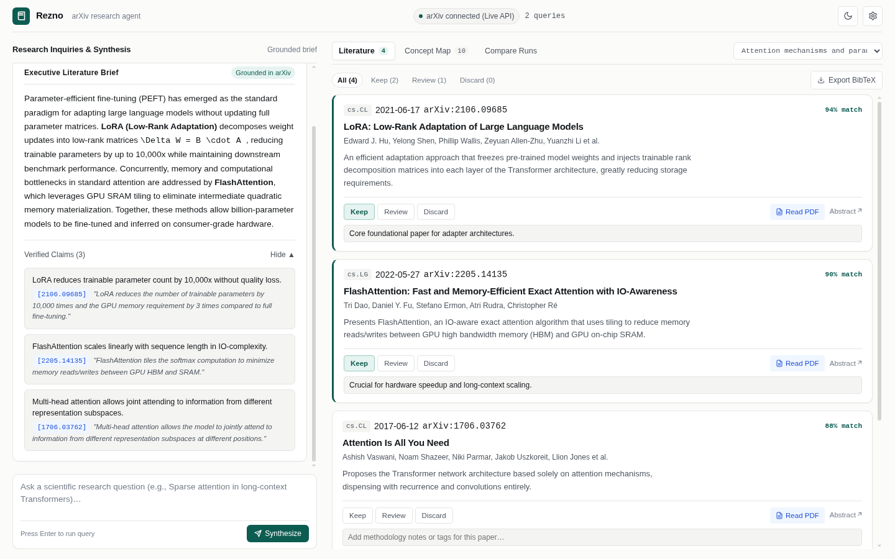
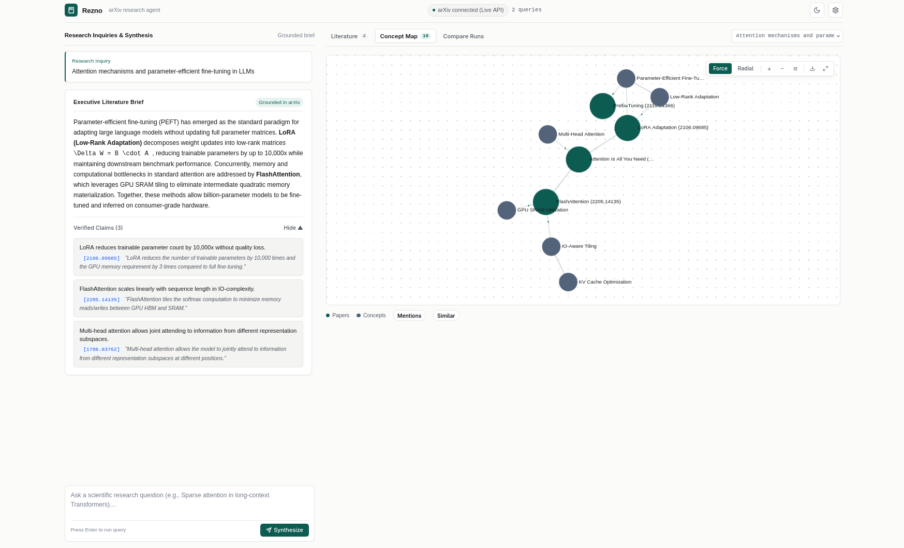

<div align="center">

# Rezno AI

**Academic Literature Intelligence Engine**

*Semantic retrieval, grounded synthesis, and knowledge graph construction over arXiv preprints.*

[](https://www.python.org/downloads/)
[](https://fastapi.tiangolo.com)
[](LICENSE)

<br><br>

<p align="center">
  
</p>

</div>

---

## Research Interface in Action

| Literature Discovery & Evidence Desk | Topological Bipartite Concept Graph |
| :---: | :---: |
|  |  |
| *Dense semantic re-ranking with cosine relevance scores, verbatim abstract evidence, and instant arXiv PDF access.* | *Interactive topological knowledge graph mapping `Paper ──MENTIONS──▶ Concept` and semantic `SIMILAR_TO` edges.* |

---

## The Problem

Searching academic literature with natural language breaks down in three distinct ways:

**1. Lexical mismatch.** arXiv uses Apache Lucene boolean keyword matching. A query like *"how to make LLMs remember long documents cheaply"* simply does not match papers that use the formal phrasing *"sliding-window attention with sub-quadratic memory complexity."* Relevant work is missed at the retrieval stage before any ranking even occurs.

**2. Hallucinated citations.** General-purpose LLMs asked to synthesize research frequently invent paper titles, attribute findings to the wrong authors, or conflate results across unrelated preprints. Vanilla RAG architectures do not solve this — they only constrain the generation context, not the faithfulness of extracted claims.

**3. Isolated papers.** A ranked list of papers does not reveal which works share methodological lineage, build on the same concepts, or represent competing approaches. Discovery is linear when it should be topological.

---

## How It Works

Rezno AI runs a deterministic, six-stage pipeline. No autonomous agent loops — every step is typed, bounded, and auditable.

```
[User Query]
     │
     ▼
1. plan_query     → LLM expands 1 prompt into 3–4 formal Lucene boolean queries
                    targeting canonical terms, method variants, and arXiv categories
     │
     ▼
2. search         → Threaded parallel fetch from arXiv API, 25s timeout per query,
                    failures isolated per-thread, empty-pool returned on full timeout
     │
     ▼
3. rank           → all-MiniLM-L6-v2 (384-dim) encodes titles + abstracts,
                    unit-normalized cosine dot product scores the full candidate pool
     │
     ▼
4. synthesize     → Gemini Flash generates a prose summary + per-claim verbatim quotes
                    Every claim must be matched character-for-character to an abstract
                    sentence. Unverifiable claims are dropped before the response is returned
     │
     ▼
5. graph          → Bipartite knowledge graph:
                    Paper ──MENTIONS──▶ Concept (from synthesis insights)
                    Paper ──SIMILAR_TO──▶ Paper (top-k cosine neighbors, deduplicated)
     │
     ▼
6. route          → Intent classifier routes follow-up messages to grounded Q&A,
                    fresh arXiv retrieval, or broad Tavily web search
```

**Zero-hallucination guarantee:** `SupportedClaim.supporting_sentence` stores the exact verbatim sentence from the abstract. If the LLM cannot produce a character-exact match, the claim is rejected and not shown to the user.

---

## Key Architectural Decisions

Full decision rationale lives in [DECISIONS.md](DECISIONS.md). The most consequential choices:

**Sequential pipeline over autonomous agent.** An earlier prototype used an LLM agent that called `arxiv_search`, `rank_papers`, and `build_graph` as tools in a loop. It was unpredictable, expensive, and hard to evaluate. The current deterministic pipeline runs in under 10s, costs ~70% fewer tokens, and is fully reproducible — which matters for academic credibility.

**Verbatim claim verification, not similarity.** A common approach is to check claim-to-source similarity with a threshold (e.g. ≥ 0.8 cosine). We require an exact substring match instead. The cost: synthesis occasionally drops claims the LLM could not perfectly quote. The benefit: zero risk of a paraphrased claim diverging from what the paper actually says.

**Dense re-ranking over a large candidate pool, not top-N keyword results.** We fetch 100–500 candidates from arXiv (keyword match) and re-rank the entire pool with MiniLM. This separates retrieval failure (pool recall) from ranking failure (Recall@k) — a distinction the evaluation harness explicitly benchmarks.

**Gemini model allocation by task.** `gemini-3.8-flash` is used for synthesis (requires verbatim extraction over long abstracts). `gemini-3.5-flash-lite` is used for query planning and routing (simpler classification tasks, 15 RPM free-tier limit vs. 5 RPM). Rate limiting is enforced with a sliding-window token bucket per model, with exponential backoff on 429/503 responses.

**Unified single-server deployment.** The FastAPI backend mounts the entire `frontend/` directory at `/`. One command (`uvicorn backend.api.main:app`) serves both the interactive web UI and all API endpoints with no CORS configuration needed.

**Resilient offline frontend.** The frontend state machine probes `/api/health` on startup. If the backend is unreachable, it transparently falls back to `js/mock_data.js` — the UI remains fully interactive for demos and development without a running server.

---

## Quickstart

**Prerequisites:** Python ≥ 3.11

```bash
git clone https://github.com/Shrikantlala25/Rezno_AI.git
cd Rezno_AI

# Install dependencies
uv sync
# or: pip install -r requirements.txt
```

**Configure API key** (required for query expansion and synthesis):
```bash
# .env
GEMINI_API_KEY=your_key_here
```

**Launch:**
```bash
uvicorn backend.api.main:app --reload --port 8000
# Open http://localhost:8000
```

**CLI:**
```bash
python -m backend.cli --query "speculative decoding in LLM inference" --top-k 10
```

**Run tests:**
```bash
pytest tests/                        # all offline unit tests
pytest tests/ -m live_api            # live API connectivity test (uses 1 API call)
```

### Pytest Verification Results


#### Mathematical & Algorithmic Invariants

| Test Case | Invariant / Property Verified | Status |
| :--- | :--- | :---: |
| `test_sequential_run_isolation` | Consecutive queries never leak candidate papers, cached embeddings, or concepts | **PASSED** |
| `test_graph_orphan_filtering` | Graph insights referencing non-existent candidate paper IDs are dropped | **PASSED** |
| `test_claim_attribution_fidelity` | Claims without character-exact abstract supporting sentences are rejected | **PASSED** |
| `test_network_timeout_and_empty_pool` | Search network timeouts & empty candidate pools return clean fallbacks | **PASSED** |
| `test_live_gemini_api_connectivity` | Opt-in live test validating `google-genai` SDK and rate-limit backoff | **PASSED** |

---

## Evaluation

The evaluation harness in `backend/evaluation/` measures retrieval quality against hand-curated ground-truth cases across four research domains.

```bash
python -m backend.evaluation.evaluate --top-k 20 --expand
```

Metrics reported: **Pool Recall** (did arXiv return the paper at all?), **Recall@k** (did MiniLM rank it in the top-k?), **MRR** (mean reciprocal rank of the first hit).

---

## Repository Structure

```
Rezno_AI/
├── backend/
│   ├── api/            # FastAPI endpoints (/api/health, /api/search, /api/synthesize SSE)
│   ├── core/           # Pipeline, retrieval, re-ranking, synthesis, graph, routing
│   ├── integrations/   # LLM (google-genai), citations, BibTeX, web search
│   └── evaluation/     # Benchmarks and diagnostics
├── frontend/           # Zero-build HTML5 / Tailwind / D3.js web interface
├── tests/              # Pure pytest suite (59 offline tests, 1 live API test)
├── docs/               # Architecture deep dives and decision history
├── Version_1/          # Zero-breakage backward-compatibility shims
├── legacy/reflex_v1/   # Archived Reflex prototype (preserved, not in active use)
├── AGENTS.md           # AI agent onboarding guide
├── DECISIONS.md        # Architectural Decision Records (ADRs)
└── PROJECT.md          # Full system specification
```

---

## Current Limitations

- **arXiv only.** The retrieval pipeline is designed around the arXiv API. PubMed, Semantic Scholar, and ACL Anthology are not currently integrated.
- **Abstract-level synthesis.** Claims are grounded against abstracts, not full paper PDFs. Deep methodological claims buried in Section 3 of a paper are out of reach.
- **Free-tier rate limits.** On the Google Gemini free tier, query expansion and synthesis are throttled to 5–15 RPM. High-volume batch evaluation will hit rate limits and retry with exponential backoff.
- **English only.** The MiniLM embedding model and the LLM prompts are optimized for English-language queries and abstracts.
- **No persistent session storage.** Conversation history and graph state are held in browser memory only. Reloading the page resets the session.

---

## Contributors

| Name | Role |
|------|------|
| [Shrikant Lala](https://github.com/Shrikantlala24) | Project Creator — original concept, prototype, and pipeline design |
| [Saksham Shukla](https://github.com/gradient-ghost) | Core Contributor — architecture decoupling, native GenAI SDK migration, rate-limiting engine, hybrid frontend, and test infrastructure |
| [Viraj Shirodkar](https://github.com/viraj-sh) | Core Contributor | 

---

## Citation

```bibtex
@software{rezno_ai_2026,
  author  = {Shrikant Lala, Saksham Shukla, Viraj Shirodkar},
  title   = {Rezno AI: Academic Literature Intelligence with Grounded Claim Verification},
  url     = {https://github.com/Shrikantlala24/Rezno_AI},
  year    = {2026}
}
```
